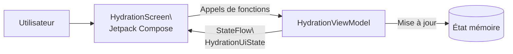

::: {align="center"}
# 💧 HydroFlow

### Suivez votre hydratation, un verre à la fois.

Application Android native de suivi d'hydratation quotidienne,
construite avec Kotlin et Jetpack Compose.

```{=html}
<p>
```
``{=html}
``{=html}
``{=html}
``{=html}
``{=html}
``{=html}
```{=html}
</p>
```
:::

------------------------------------------------------------------------

HydroFlow est une application Android native de suivi d'hydratation
quotidienne. Elle permet d'ajouter une consommation d'eau par paliers de
250 ml, de visualiser l'avancement vers un objectif de 2 000 ml, de
consulter les entrées du jour et de supprimer ou réinitialiser ces
données.

Le projet est développé avec **Kotlin**, **Jetpack Compose**, **Material
3** et l'architecture **MVVM**. Son interface utilise un thème sombre
personnalisé avec une couleur turquoise.

> **Version documentée :** 1.0

> **Application ID :** `com.example.hydroflow`

> **Namespace Kotlin/Android :** `com.example.hydroflow`

------------------------------------------------------------------------

## Table des matières\*\*

1.  [Fonctionnalités](#1-fonctionnalités)

2.  [Démonstration des écrans](#2-démonstration-des-écrans)

3.  [Architecture technique](#3-architecture-technique)

4.  [Structure du dépôt](#4-structure-du-dépôt)

5.  [Modèle de données](#5-modèle-de-données)

6.  [Gestion de l'état](#6-gestion-de-létat)

7.  [Interface utilisateur](#7-interface-utilisateur)

8.  [Prérequis](#8-prérequis)

9.  [Installation et lancement](#9-installation-et-lancement)

10. [Compilation](#10-compilation)

11. [Tests](#11-tests)

12. [Build de production](#12-build-de-production)

13. [Comportements connus et
    limites](#13-comportements-connus-et-limites)

14. [Évolutions recommandées](#14-évolutions-recommandées)

15. [Dépannage](#15-dépannage)

16. [Références techniques](#16-références-techniques)

------------------------------------------------------------------------

## 1. Fonctionnalités\*\*

### Fonctionnalités disponibles\*\*

-   Affichage du volume consommé dans la journée.

-   Objectif journalier fixé à **2 000 ml**.

-   Ajout rapide de **250 ml** d'eau.

-   Calcul automatique du pourcentage d'avancement.

-   Représentation graphique circulaire avec animation.

-   Message de félicitations lorsque l'objectif est atteint.

-   Affichage de l'heure de chaque consommation.

-   Suppression individuelle d'une entrée.

-   Réinitialisation complète de la consommation et de l'historique.

-   Interface adaptée au mode sombre.

### Règles fonctionnelles\*\*

| Règle \| Implémentation \|

\|---\|---\|

| Quantité ajoutée \| 250 ml via le bouton principal \|

| Objectif \| 2 000 ml \|

| Progression maximale \| Limitée à 100 % à l'affichage \|

| Objectif atteint \| `currentIntakeMl >= goalMl` \|

| Nouvelle entrée \| Placée en tête de l'historique \|

| Suppression \| Retire le volume enregistré de la consommation totale
  \|

| Réinitialisation \| Remet le volume à zéro et vide l'historique \|

------------------------------------------------------------------------

## 2. Démonstration des écrans\*\*

L'interface principale contient :

1.  une barre supérieure avec le titre **HydroFlow** ;

2.  une carte d'objectif quotidien ;

3.  un indicateur circulaire de progression ;

4.  un message d'objectif atteint ;

5.  un bouton de réinitialisation ;

6.  un bouton d'ajout de 250 ml ;

7.  une liste des consommations enregistrées.

Une capture d'écran pourra être ajoutée ici après l'exécution de
l'application :

``` markdown


```

------------------------------------------------------------------------

## 3. Architecture technique\*\*

### Vue d'ensemble\*\*

Le projet suit une architecture MVVM simplifiée :



### Responsabilités\*\*

| Composant \| Responsabilité \|

\|---\|---\|

| `MainActivity` \| Point d'entrée Android et hébergement de l'UI
  Compose \|

| `HydrationScreen` \| Affichage, interactions utilisateur et éléments
  visuels \|

| `HydrationViewModel` \| Gestion des actions métier et maintien de
  l'état \|

| `HydrationUiState` \| Représentation immuable de l'état de l'écran \|

| `WaterLog` \| Modèle d'une consommation d'eau \|

| `HydrationTheme` \| Palette de couleurs et typographie Material 3 \|

### Flux de données\*\*

1.  `HydrationScreen` collecte `viewModel.uiState`.

2.  Une modification déclenche la mise à jour d'un `MutableStateFlow`.

3.  `_uiState.update` produit un nouvel état immuable.

4.  `StateFlow` expose l'état à Compose via `asStateFlow`.

5.  La recomposition met automatiquement à jour les textes, le cercle et
    l'historique.

Les actions passent directement du composant vers le ViewModel :

``` text

HydrationScreen

  -> addWater(250)

  -> deleteLog(logId)

  -> resetIntake()

       |

       v

HydrationViewModel

       |

       v

HydrationUiState

       |

       v

HydrationScreen collecte et affiche l'état
```

------------------------------------------------------------------------

## 4. Structure du dépôt\*\*

``` text

Hydratation/

├── app/

│   ├── build.gradle.kts

│   ├── proguard-rules.pro

│   └── src/

│       ├── main/

│       │   ├── AndroidManifest.xml

│       │   ├── java/com/example/hydroflow/

│       │   │   ├── MainActivity.kt

│       │   │   └── ui/theme/

│       │   │       ├── Color.kt

│       │   │       ├── HydrationScreen.kt

│       │   │       ├── HydrationViewModel.kt

│       │   │       ├── Theme.kt

│       │   │       └── Type.kt

│       │   └── res/

│       └── test/

│           └── java/com/example/hydroflow/

│               └── ExampleUnitTest.kt

├── gradle/

│   ├── libs.versions.toml

│   └── wrapper/

├── build.gradle.kts

├── gradle.properties

├── settings.gradle.kts

├── gradlew

├── gradlew.bat

└── README.md
```

------------------------------------------------------------------------

## 5. Modèle de données\*\*

### `HydrationUiState`\*\*

``` kotlin

data class HydrationUiState(

    val currentIntakeMl: Int = 0,

    val goalMl: Int = 2000,

    val logs: List\<WaterLog> = emptyList(),

    val streakDays: Int = 3

)
```

Propriétés calculées :

-   `isGoalReached` : vrai lorsque la consommation atteint ou dépasse
    l'objectif.

-   `progressPercentage` : consommation divisée par l'objectif, limitée
    à `1f` afin d'éviter une progression supérieure à 100 %.

### `WaterLog`\*\*

``` kotlin

data class WaterLog(

    val id: String,

    val amountMl: Int,

    val timestamp: Date = Date()

)
```

L'identifiant est actuellement généré à partir de
`System.currentTimeMillis().toString()`. L'heure affichée utilise le
format local `HH:mm`.

------------------------------------------------------------------------

## 6. Gestion de l'état\*\*

Le `HydrationViewModel` expose un `StateFlow` en lecture seule :

``` kotlin

private val _uiState = MutableStateFlow(HydrationUiState())

val uiState: StateFlow\<HydrationUiState> = _uiState.asStateFlow()
```

Cette approche offre les avantages suivants :

-   état observable depuis Compose ;

-   mise à jour atomique ;

-   immutabilité de l'objet d'état exposé ;

-   recomposition ciblée de l'interface ;

-   séparation entre l'UI et les règles métier.

Chaque opération produit une copie de l'état précédent avec
`_uiState.update { ... }`. Cet état est conservé tant que l'instance du
ViewModel existe. Il est donc perdu lors d'une fermeture ou d'une
destruction complète de l'application.

------------------------------------------------------------------------

## 7. Interface utilisateur\*\*

### Technologies UI\*\*

-   Jetpack Compose

-   Material 3

-   `Scaffold`

-   `CenterAlignedTopAppBar`

-   `Card`

-   `OutlinedButton`

-   `Button`

-   `LazyColumn`

-   Canvas personnalisé

-   Animation `animateFloatAsState`

### Palette principale\*\*

| Élément \| Couleur \|

\|---\|---\|

| Accent principal \| `#00E5FF` \|

| Fond sombre \| `#121212` \|

| Surface \| `#1E1F22` \|

| Surface variante \| `#2F3036` \|

| Texte principal \| `#E3E2E6` \|

| Texte secondaire \| `#C5C6D0` \|

| Erreur/reset \| `#FFB4AB` \|

Le thème sombre est explicitement demandé par `MainActivity` :

``` kotlin

HydrationTheme(darkTheme = true)
```

Le composable conserve cependant une variante claire dans `Theme.kt`,
bien que celle-ci ne soit pas sélectionnée par défaut.

### Accessibilité\*\*

Les boutons contiennent déjà des descriptions accessibles pour les
icônes :

-   `Réinitialiser`

-   `Ajouter de l'eau`

Avant une livraison finale, il est recommandé d'ajouter des descriptions
d'accessibilité plus descriptives sur les indicateurs visuels, de
vérifier les contrastes à 200 %, et de tester la navigation au lecteur
d'écran.

------------------------------------------------------------------------

## 8. Prérequis\*\*

### Logiciels\*\*

| Élément \| Configuration du projet \|

\|---\|---\|

| Android Studio \| Version compatible avec Gradle 8.x \|

| JDK \| JDK 11 \|

| SDK Android \| `compileSdk 36` \|

| SDK cible \| `targetSdk 35` \|

| SDK minimal \| API 24 --- Android 7.0 \|

| Kotlin \| 2.0.21 \|

| Android Gradle Plugin \| 8.10.1 \|

| Gradle \| Wrapper du projet \|

### Appareil ou émulateur\*\*

-   Android 7.0 (`API 24`) minimum.

-   SDK cible configuré sur API 35 (Android 15).

-   Émulateur configuré avec Google APIs ou Google Play recommandé.

-   1 Go d'espace disque disponible au minimum pour les dépendances
    Gradle et l'émulateur.

------------------------------------------------------------------------

## 9. Installation et lancement\*\*

### Installation depuis Android Studio\*\*

1.  Installer Android Studio.

2.  Ouvrir Android Studio.

3.  Choisir **Open** puis sélectionner le dossier `C:\Hydratation`.

4.  Attendre la synchronisation Gradle.

5.  Autoriser Android Studio à télécharger les composants SDK demandés.

6.  Créer ou démarrer un émulateur via **Device Manager**.

7.  Sélectionner le module `app`.

8.  Cliquer sur **Run**.

### Installation depuis Git\*\*

``` powershell

git clone \<URL_DU_DEPOT>

cd \<DOSSIER_DU_DEPOT>
```

Puis ouvrir le dossier avec Android Studio et lancer le module `app`.

### Premier lancement depuis la ligne de commande\*\*

Depuis la racine du projet :

``` powershell

.\gradlew.bat assembleDebug

.\gradlew.bat installDebug
```

L'APK généré se trouve dans :

``` text

app/build/outputs/apk/debug/app-debug.apk
```

------------------------------------------------------------------------

## 10. Compilation\*\*

### Vérifier l'environnement Gradle\*\*

``` powershell

.\gradlew.bat --version
```

### Compiler les sources\*\*

``` powershell

.\gradlew.bat compileDebugKotlin
```

### Assembler une version debug\*\*

``` powershell

.\gradlew.bat assembleDebug
```

### Vérifier les modifications avec les tests locaux\*\*

``` powershell

.\gradlew.bat testDebugUnitTest
```

### Exécuter les tests instrumentés\*\*

Avec un émulateur ou un appareil connecté :

``` powershell

.\gradlew.bat connectedDebugAndroidTest
```

### Nettoyer puis reconstruire\*\*

``` powershell

.\gradlew.bat clean

.\gradlew.bat assembleDebug
```

------------------------------------------------------------------------

## 11. Tests\*\*

### Tests unitaires\*\*

Le fichier `ExampleUnitTest.kt` contient un test d'exemple basé sur
JUnit :

``` kotlin

assertEquals(4, 2 + 2)
```

Ce test valide le moteur JUnit mais ne teste pas le comportement métier
du ViewModel.

### Tests instrumentés\*\*

Le fichier `ExampleInstrumentedTest.kt` vérifie que le package de
l'application est correct sur un appareil ou un émulateur.

### Qualité attendue pour une évolution\*\*

Les éléments métier suivants devraient être couverts :

| Cas de test \| Résultat attendu \|

\|---\|---\|

| Ajout de 250 ml \| Consommation = 250 ml \|

| Ajout sur plusieurs appels \| Somme cumulative correcte \|

| Suppression d'une entrée \| Volume retiré et entrée supprimée \|

| Suppression inconnue \| Aucun changement de volume \|

| Réinitialisation \| Volume zéro et historique vide \|

| Objectif atteint \| `isGoalReached == true` \|

| Dépassement \| Pourcentage plafonné à 100 % \|

| Identifiant absent \| Suppression sans effet \|

------------------------------------------------------------------------

## 12. Build de production\*\*

La configuration `release` active actuellement uniquement la génération
du bundle/application, avec `isMinifyEnabled = false`. Aucun
`signingConfig` personnalisé n'est défini dans le module.

Pour produire une APK release :

``` powershell

.\gradlew.bat assembleRelease
```

Les fichiers sont générés sous :

``` text

app/build/outputs/apk/release/
```

Avant publication sur Google Play :

-   configurer une clé de signature dédiée ;

-   conserver cette clé dans un endroit sécurisé ;

-   activer R8/minification après tests ;

-   ajouter les règles ProGuard nécessaires ;

-   tester une vraie APK release signée ;

-   vérifier les permissions, les versions et les métadonnées ;

-   utiliser Android App Bundle pour Google Play.

------------------------------------------------------------------------

## 13. Comportements connus et limites\*\*

| Sujet \| Situation actuelle \|

\|---\|---\|

| Persistance \| Aucun stockage local : les données disparaissent au
  redémarrage \|

| Streak \| Valeur d'exemple fixe à 3 jours \|

| Objectif \| Fixé à 2 000 ml \|

| Quantité \| Un seul bouton à 250 ml \|

| Jours \| Pas de changement automatique de journée \|

| Historique \| Conservé uniquement en mémoire \|

| Base de données \| Absente \|

| API réseau \| Absente \|

| Notifications \| Aucune \|

| Profil utilisateur \| Aucun \|

| Authentification \| Aucune \|

| Modification du profil \| Aucun réglage d'objectif \|

### Implications\*\*

Une rotation d'écran n'entraîne pas forcément une perte des données
puisque le ViewModel peut survivre à certains changements de
configuration. En revanche, la fermeture complète du processus ou du
composant propriétaire détruit l'état.

Le streak doit être considéré comme une valeur démonstrative tant qu'un
historique journalier persistant n'est pas implémenté.

------------------------------------------------------------------------

## 14. Évolutions recommandées\*\*

Ces évolutions sont priorisées pour transformer le prototype en
application complète :

### Priorité haute\*\*

1.  Ajouter Room ou DataStore pour persister les consommations.

2.  Reprendre les données au lancement.

3.  Réinitialiser automatiquement l'état à minuit.

4.  Ajouter des tests unitaires du ViewModel.

5.  Remplacer le streak fixe par un calcul basé sur les jours complétés.

### Priorité moyenne\*\*

1.  Permettre de personnaliser l'objectif quotidien.

2.  Permettre plusieurs quantités prédéfinies.

3.  Autoriser la saisie d'une quantité personnalisée.

4.  Ajouter un historique sur plusieurs jours.

5.  Ajouter des statistiques quotidiennes, hebdomadaires et mensuelles.

6.  Ajouter des notifications de rappel locales.

### Priorité basse\*\*

1.  Ajouter des préférences de thème.

2.  Ajouter des animations de transition.

3.  Ajouter une synchronisation cloud.

4.  Ajouter l'export des données.

5.  Mettre en place CI/CD avec analyse de qualité.

------------------------------------------------------------------------

## 15. Dépannage\*\*

### SDK Android 36 introuvable\*\*

Dans Android Studio :

1.  ouvrir **Settings / SDK Manager** ;

2.  sélectionner **SDK Platforms** ;

3.  installer la plateforme correspondant à API 36 ;

4.  synchroniser Gradle.

### Synchronisation Gradle impossible\*\*

-   vérifier la connexion Internet ;

-   vérifier que les dépôts sont disponibles ;

-   exécuter :

``` powershell

.\gradlew.bat --refresh-dependencies
```

### JDK incorrect\*\*

-   ouvrir Android Studio ;

-   aller dans **Settings \> Build, Execution, Deployment \> Build Tools
    \> Gradle** ;

-   sélectionner JDK 11 ou **Gradle JVM : JDK 11** ;

-   redémarrer Android Studio si nécessaire.

### Application qui ne démarre pas sur l'émulateur\*\*

``` powershell

adb devices
```

Si aucun appareil n'apparaît :

1.  démarrer l'émulateur ;

2.  redémarrer ADB ;

``` powershell

adb kill-server

adb start-server

adb devices
```

Puis relancer l'application.

### APK déjà installé avec une ancienne signature\*\*

Désinstaller l'ancien package depuis les paramètres de l'émulateur, puis
réinstaller :

``` powershell

adb uninstall com.example.hydroflow

.\gradlew.bat installDebug
```

------------------------------------------------------------------------

## 16. Références techniques\*\*

-   Android Developers : https://developer.android.com/

-   Jetpack Compose : https://developer.android.com/develop/ui/compose

-   Architecture MVVM Android :
    https://developer.android.com/topic/architecture

-   Material 3 : https://m3.material.io/

-   Kotlin : https://kotlinlang.org/docs/home.html

-   Gradle for Android : https://developer.android.com/build

------------------------------------------------------------------------

## Licence\*\*

Le projet HydroFlow est distribué sous licence [MIT](LICENSE).

Le texte complet des conditions est disponible dans le fichier
[LICENSE](LICENSE). Cette licence autorise notamment l'utilisation, la
modification, la redistribution et la publication du code, sous réserve
de conserver l'avis de copyright et la notice de licence.
